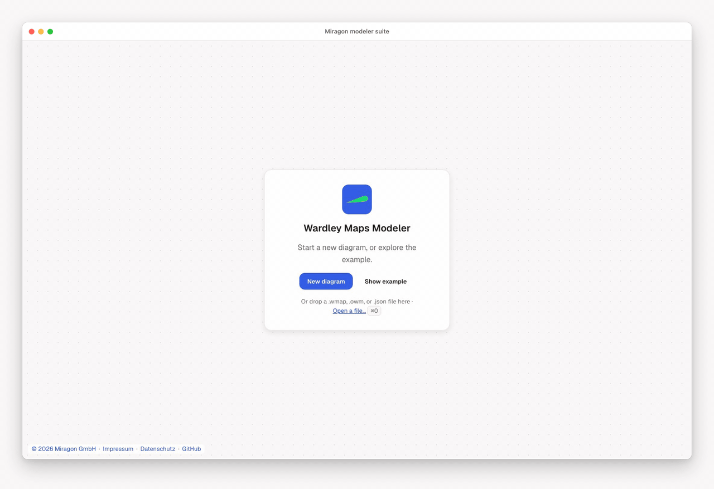

# Miragon modeler suite

[](https://github.com/Miragon/modeler-suite/actions/workflows/ci.yml)
[](LICENSE)

The Miragon modeler platform in one repository: ONE contract every Miragon modeler implements, the
shared chrome around their canvases, and the five modelers built on the two. Each modeler is one
notation: a plain-text file is the source of truth, a [diagram-js](https://github.com/bpmn-io/diagram-js)
renderer shows and edits it, and a web app and a VS Code extension put the renderer in front of
users. Every package and extension keeps its own version and its own npm or Marketplace name.



## Modelers

| Modeler                                               | Files                                                 | Web app                                                                          | VS Code extension                                                                                                                                                                         |
| ----------------------------------------------------- | ----------------------------------------------------- | -------------------------------------------------------------------------------- | ----------------------------------------------------------------------------------------------------------------------------------------------------------------------------------------- |
| [Wardley Maps](modelers/wardley-maps/README.md)       | `.wmap`, `.owm` (OWM text DSL)                        | [wardley-maps.modeler.miragon.io](https://wardley-maps.modeler.miragon.io)       | [Marketplace](https://marketplace.visualstudio.com/items?itemName=miragon-gmbh.wardley-mapping-modeler) · [Open VSX](https://open-vsx.org/extension/miragon-gmbh/wardley-mapping-modeler) |
| [Event Storming](modelers/event-storming/README.md)   | `.storm` (line DSL)                                   | [event-storming.modeler.miragon.io](https://event-storming.modeler.miragon.io)   | [Marketplace](https://marketplace.visualstudio.com/items?itemName=miragon-gmbh.event-storming-modeler) · [Open VSX](https://open-vsx.org/extension/miragon-gmbh/event-storming-modeler)   |
| [Team Topologies](modelers/team-topologies/README.md) | `.tt`, `.ttm.json`, editable `*.tt.png`               | [team-topologies.modeler.miragon.io](https://team-topologies.modeler.miragon.io) | [Marketplace](https://marketplace.visualstudio.com/items?itemName=miragon-gmbh.team-topologies-modeler) · [Open VSX](https://open-vsx.org/extension/miragon-gmbh/team-topologies-modeler) |
| [Context Maps](modelers/context-maps/README.md)       | `.cm`, `.cm.json`, editable `*.cm.png`; `.cml` in/out | [context-maps.modeler.miragon.io](https://context-maps.modeler.miragon.io)       | [Marketplace](https://marketplace.visualstudio.com/items?itemName=miragon-gmbh.context-maps-modeler) · [Open VSX](https://open-vsx.org/extension/miragon-gmbh/context-maps-modeler)       |
| [Value Chain](modelers/value-chain/README.md)         | `.vc`, `.vc.json`                                     | no public deployment yet; run it locally                                         | [Marketplace](https://marketplace.visualstudio.com/items?itemName=miragon-gmbh.value-chain-modeler)                                                                                       |

Their libraries on npm, each in `modelers/<modeler>/packages/<package>`:

- **Wardley Maps:** [`@miragon/wardley-schema-model`](https://www.npmjs.com/package/@miragon/wardley-schema-model), [`@miragon/wardley-dsl`](https://www.npmjs.com/package/@miragon/wardley-dsl), [`@miragon/wardley-transforms`](https://www.npmjs.com/package/@miragon/wardley-transforms), [`@miragon/wardley-renderer`](https://www.npmjs.com/package/@miragon/wardley-renderer)
- **Event Storming:** [`@miragon/event-storming-schema-model`](https://www.npmjs.com/package/@miragon/event-storming-schema-model), [`@miragon/event-storming-dsl`](https://www.npmjs.com/package/@miragon/event-storming-dsl), [`@miragon/event-storming-transforms`](https://www.npmjs.com/package/@miragon/event-storming-transforms), [`@miragon/event-storming-renderer`](https://www.npmjs.com/package/@miragon/event-storming-renderer)
- **Team Topologies:** [`@miragon/team-topologies-schema-model`](https://www.npmjs.com/package/@miragon/team-topologies-schema-model), [`@miragon/team-topologies-renderer`](https://www.npmjs.com/package/@miragon/team-topologies-renderer)
- **Context Maps:** [`@miragon/context-maps-schema-model`](https://www.npmjs.com/package/@miragon/context-maps-schema-model), [`@miragon/context-maps-cml`](https://www.npmjs.com/package/@miragon/context-maps-cml), [`@miragon/context-maps-renderer`](https://www.npmjs.com/package/@miragon/context-maps-renderer)
- **Value Chain:** [`@miragon/value-chain-schema-model`](https://www.npmjs.com/package/@miragon/value-chain-schema-model), [`@miragon/value-chain-renderer`](https://www.npmjs.com/package/@miragon/value-chain-renderer)

The `schema-model`, `dsl`, `transforms` and `cml` packages are DOM-free and run in any JavaScript
runtime; the `renderer` packages are the diagram-js viewers and modelers. How to embed one is in
its modeler's README.

## Shared packages

| Package                                    | Path             | Status                                                                                                                                                                                                                                                       |
| ------------------------------------------ | ---------------- | ------------------------------------------------------------------------------------------------------------------------------------------------------------------------------------------------------------------------------------------------------------ |
| [`@miragon/modeler-api`](packages/api)     | `packages/api`   | the collaborative-modeler contract and its conformance kit, 0 runtime dependencies                                                                                                                                                                           |
| [`@miragon/modeler-shell`](packages/shell) | `packages/shell` | the shared chrome around diagram-js modelers (menu, palette skin, zoom panel, keys, fit, VS Code plumbing), its conformance kit and a smoke-test driver for a real VS Code (also in a Linux container), 0 runtime dependencies, [API](packages/shell/API.md) |

Every renderer implements the contract and runs its conformance kit; both apps of every modeler
mount the shell and run the shell's conformance kit. The contract's laws, the conformance kit and
its versioning are documented in the [package README](packages/api/README.md). The plan for the
shell, the contract roadmap and the rollout across the modelers live in
[#4](https://github.com/Miragon/modeler-suite/issues/4).

- [Shell implementation notes](docs/shell/implementation-notes.md): how
  `@miragon/modeler-shell` implements the chrome anatomy and the IDE-host
  rules of the Miragon design system with diagram-js, VS Code and browser
  APIs, section by section, with the rule each section implements.

## Claude Code plugins

One marketplace, [`.claude-plugin/marketplace.json`](.claude-plugin/marketplace.json), serves the
plugins of the suite:

```text
/plugin marketplace add Miragon/modeler-suite
/plugin install wardley-maps-modeler@modeler-suite
/plugin install event-storming-modeler@modeler-suite
/plugin install team-topologies-modeler@modeler-suite
/plugin install modeler-kit@modeler-suite
```

| Plugin                                                                                | Skills                         | For                                                                            |
| ------------------------------------------------------------------------------------- | ------------------------------ | ------------------------------------------------------------------------------ |
| [`wardley-maps-modeler`](modelers/wardley-maps/plugins/wardley-maps-modeler)          | `wardley-mapping`, `owm-dsl`   | the Wardley Mapping method and the `.wmap` / `.owm` text format                |
| [`event-storming-modeler`](modelers/event-storming/plugins/event-storming-modeler)    | `event-storming`, `storm-dsl`  | the Event Storming method and the `.storm` text format                         |
| [`team-topologies-modeler`](modelers/team-topologies/plugins/team-topologies-modeler) | `team-topologies`, `tt-format` | the Team Topologies method and the `.tt` / `.ttm.json` format, with a checker  |
| [`modeler-kit`](plugins/modeler-kit)                                                  | `new-modeler`                  | building a new Miragon modeler on these two packages, with a runnable template |

Value Chain's notation skill is a project skill in
[`modelers/value-chain/.claude/skills/`](modelers/value-chain/.claude/skills/), not a plugin.
Drift tests keep the plugins in step with the code (see [CONTRIBUTING.md](CONTRIBUTING.md#claude-code-plugins)).

## Quick start

Node `^22.22.2` or `>=24.15.0` and npm. From the repository root:

```sh
npm ci
npm run build:shared                   # @miragon/modeler-api and @miragon/modeler-shell, which every modeler links
npm run wardley-maps dev:webapp:plain  # the Wardley Maps web app on Vite, http://127.0.0.1:5180
npm run wardley-maps build             # the Wardley Maps packages: its tests resolve them from dist
npm run wardley-maps test              # its unit tests
npm test                               # the shared packages, the repository checks and every modeler's unit tests
npm run lint                           # type checks and ESLint, everywhere
```

`npm run <modeler> <script>` runs a script of one modeler (`wardley-maps`, `event-storming`,
`team-topologies`, `context-maps`, `value-chain`), `npm run modelers <script>` runs it for all
five. [CONTRIBUTING.md](CONTRIBUTING.md) lists the scripts, the dev servers, the browser, e2e and
VS Code tests, the pre-commit hook and the conventions for commits and pull requests;
[docs/ci-and-releases.md](docs/ci-and-releases.md) explains CI and releases.

## Layout

```text
packages/
  api/                 @miragon/modeler-api: the collaborative-modeler contract and its conformance kit
  shell/               @miragon/modeler-shell: the shared chrome, its conformance kit, the VS Code smoke driver
modelers/
  wardley-maps/        ─┐ each: packages/ (npm libraries), apps/webapp, apps/vscode, e2e/,
  event-storming/       │ example/, docs/, and README.md, CLAUDE.md, CONTRIBUTING.md for what
  team-topologies/      │ is special to its notation
  context-maps/         │
  value-chain/         ─┘
tooling/               the ESLint and dependency-cruiser presets; each modeler names its DOM-free packages in package.json
plugins/modeler-kit/   the Claude Code plugin with the new-modeler skill and its template
.claude-plugin/        the suite's Claude Code marketplace
test/                  repository-level checks: the modeler-kit drift test, every modeler's boundaries, Dependabot auto-merge
docs/                  shell implementation notes, CI and releases
```

## Contributing

See [CONTRIBUTING.md](CONTRIBUTING.md), and for each modeler its own
[Wardley Maps](modelers/wardley-maps/CONTRIBUTING.md), [Event Storming](modelers/event-storming/CONTRIBUTING.md),
[Team Topologies](modelers/team-topologies/CONTRIBUTING.md), [Context Maps](modelers/context-maps/CONTRIBUTING.md)
and [Value Chain](modelers/value-chain/CONTRIBUTING.md) notes. Agent-oriented rules are in
[CLAUDE.md](CLAUDE.md).

## License

MIT
