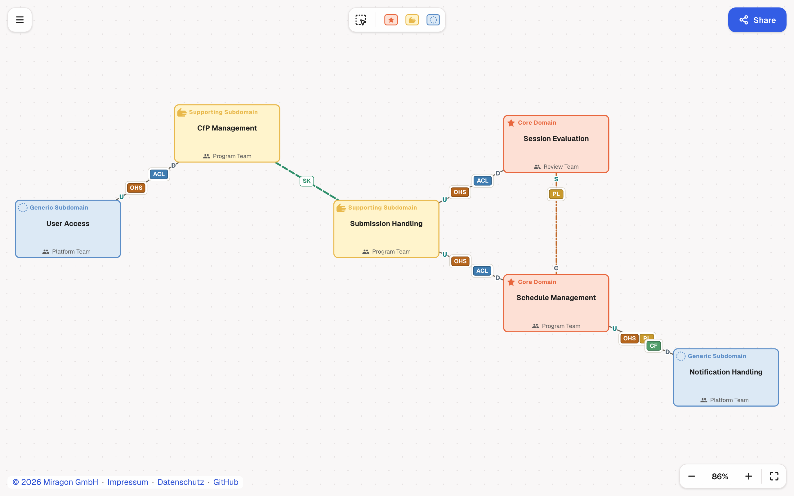
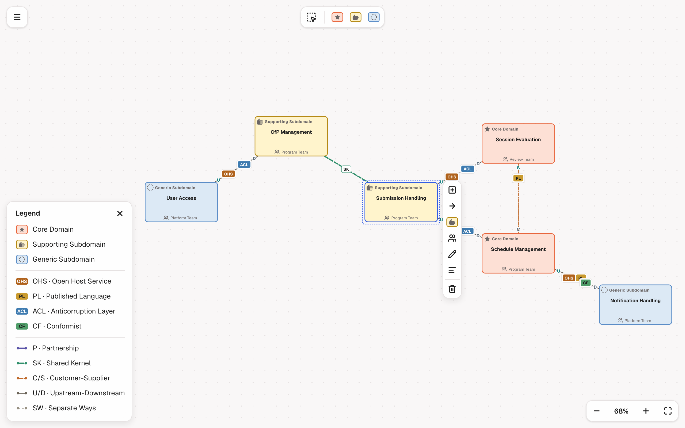

# Context Maps Modeler

[](LICENSE)
[](https://github.com/Miragon/modeler-suite/actions/workflows/ci.yml)
[](https://www.npmjs.com/package/@miragon/context-maps-renderer)
[](https://marketplace.visualstudio.com/items?itemName=miragon-gmbh.context-maps-modeler)

A fast, offline-friendly modeler for **Context Maps** diagrams — the strategic Domain-Driven Design
context maps: bounded contexts coloured by subdomain type, connected by context-mapping relationship
patterns. Ships as a **web app**
and a **VS Code extension** sharing one diagram-js core.

Built with a "full-bleed canvas + floating chrome" editing feel, a clean DOM-free domain model, and
lossless, version-controllable files — all around the Context Maps notation — as
`modelers/context-maps` of the [Miragon modeler suite](../../README.md).

**[Try the web app →](https://context-maps.modeler.miragon.io)**





## Notation

Bounded contexts are boxes, coloured by **subdomain type**; relationships are lines carrying a
**context-mapping pattern** abbreviation plus U/D end markers for the asymmetric ones. Line weight
encodes coordination bandwidth (partnership / shared kernel are thick, separate ways is thin). The
single source of truth for the colours and strokes below is
[`packages/schema-model/src/notation.ts`](packages/schema-model/src/notation.ts).

### Subdomain types

| Type                 | Icon          | Fill / Outline        | Purpose                                    |
| -------------------- | ------------- | --------------------- | ------------------------------------------ |
| Core Domain          | star          | `#FDE0D5` / `#E8663D` | Business-critical and differentiating.     |
| Supporting Subdomain | open hand     | `#FFF4CC` / `#E8B84B` | Specialised, but not differentiating.      |
| Generic Subdomain    | dotted circle | `#DCE9F5` / `#5B8DC7` | Solved / off-the-shelf — buy, don't build. |

### Relationship patterns

| Pattern             | Abbr. | Stroke                  | Symmetry   |
| ------------------- | ----- | ----------------------- | ---------- |
| Partnership         | P     | indigo, thick solid     | symmetric  |
| Shared Kernel       | SK    | green, thick long-dash  | symmetric  |
| Customer-Supplier   | C/S   | orange, dash-dot        | asymmetric |
| Upstream-Downstream | U/D   | grey, thin solid        | asymmetric |
| Separate Ways       | SW    | light grey, fine dotted | symmetric  |

Asymmetric relationships carry **integration roles** at their ends: upstream can be an
**Open Host Service (OHS)** and/or a **Published Language (PL)**; downstream can apply an
**Anticorruption Layer (ACL)** or be a **Conformist (CF)** (the two are mutually exclusive). Thirteen
semantic rules — ten adopted from Context Mapper (OHS/PL only upstream, ACL/CF only downstream,
symmetric patterns carry no roles, etc.), two advisory warnings (a core domain should not conform, a
shared kernel should not span two teams), and at most one relationship per pair of contexts — are
checked by `validateDocument()`.

## Targets

- **Web app** ([`apps/webapp`](apps/webapp/README.md)) — a Vite editor in the same Miragon modeler
  chrome ([`@miragon/modeler-shell`](https://www.npmjs.com/package/@miragon/modeler-shell), web
  host): a full-bleed canvas with palette, context pad, legend, zoom panel and problems list, a
  start screen, a page-wide drop zone for `.cm`, `.json` and `.cml` files, PNG/SVG/JSON/CML
  export and a shareable, self-contained URL (LZ-compressed, no backend). Deployed on Netlify.
- **VS Code extension** ([`apps/vscode`](apps/vscode/README.md)) — a custom editor for `.cm` and
  `.cm.json` files inside the shared Miragon modeler chrome
  ([`@miragon/modeler-shell`](https://www.npmjs.com/package/@miragon/modeler-shell)): the JSON file
  stays the source of truth (save, Git, diff and undo keep working), the semantic rules show in the
  Problems view, and editable embedded-PNG diagrams (`*.cm.png`) let you drop a diagram into a wiki
  or README and still edit it graphically. Context Mapper `.cml` maps import and export via
  [`packages/cml`](packages/cml).

The renderer implements the collaborative-modeler contract of
[`@miragon/modeler-api`](https://www.npmjs.com/package/@miragon/modeler-api) and runs its conformance
kit, so collaborative hosts embed it without per-modeler knowledge.

Both targets share the published packages:

| Package                                                                 | Purpose                                                                          | DOM |
| ----------------------------------------------------------------------- | -------------------------------------------------------------------------------- | --- |
| [`@miragon/context-maps-schema-model`](packages/schema-model/README.md) | Types, the notation spec, Zod validation, migrations, deterministic JSON         | no  |
| [`@miragon/context-maps-cml`](packages/cml)                             | Context Mapper CML ↔ document                                                    | no  |
| [`@miragon/context-maps-renderer`](packages/renderer/README.md)         | diagram-js viewer/modeler, custom rendering, palette, context pad, import/export | yes |

## Getting started

Requires Node `^22.22.2` or `>=24.15.0` and npm; the Portless dev server needs Node ≥ 24.15. From
the root of the suite:

```bash
npm ci && npm run build:shared        # once: every workspace, the shared packages
npm run context-maps dev:webapp       # start the webapp dev server (prints a stable .localhost URL; Portless)
npm run context-maps dev:vscode       # watch-build the VS Code extension (then F5 in VS Code)
npm run context-maps test             # unit tests (Vitest)
npm run context-maps test:browser     # renderer and the modeler-api conformance kit in Chromium
npm run context-maps test:e2e         # Playwright: the web app and the VS Code webview (with the shell's kit)
npm run context-maps test:vscode      # the packaged extension in a real VS Code window (see CONTRIBUTING.md)
npm run context-maps lint             # eslint + type-check
npm run context-maps build            # build the publishable packages (schema-model, cml, renderer)
```

On your machine, run the VS Code smoke test with `npm run context-maps test:vscode:docker`: the
same test in a Linux container, so no window opens and nothing takes the focus (needs Docker).

## Architecture

npm workspaces inside the suite's one workspace, with a strict boundary between the pure model and
the view:

```
packages/
  schema-model/  @miragon/context-maps-schema-model — DOM-free core: types, notation spec, Zod schema,
                                            deterministic JSON, migrations, factory, the example.
  cml/           @miragon/context-maps-cml          — DOM-free Context Mapper CML parser and serializer.
  renderer/      @miragon/context-maps-renderer     — diagram-js bootstrap: viewer/modeler, renderer, palette,
                                            context-pad, label editing, import/export, CSS, the
                                            collaborative-modeler contract.
apps/
  webapp/        @miragon/context-maps-webapp       — Vite editor application on the modeler shell.
  vscode/        context-maps-modeler  — VS Code custom editors for .cm/.cm.json and *.cm.png.
e2e/                                       — Playwright end-to-end tests: the webapp and the VS Code webview.
```

The `schema-model` package compiles **without the DOM lib**, so a stray browser import fails
type-checking. The DOM boundary is enforced twice — by ESLint and by dependency-cruiser. The apps and
tests consume the packages straight from their TS source via Vite/esbuild/tsconfig aliases, so there
is no separate library build step for development (`npm run context-maps build` is only needed to
publish the libs).

Design choices:

- **Deterministic serialisation** (sorted, rounded, fixed key order) makes `.cm.json` files
  diff-friendly and gives stable share URLs.
- **Runtime validation** (Zod) on everything imported from files / URLs / localStorage, with a
  forward-migration hook keyed by document `version`.
- **diagram-js** (MIT) as the editor engine — palette, move, context pad,
  inline label editing and undo/redo for free.

## Document format

`.cm.json` is a small, stable JSON document. A map is a set of **bounded contexts** (boxes) and the
**relationships** (context-mapping patterns) that connect them via `from` → `to` context references:

```jsonc
{
  "version": 1,
  "title": "Conference event planner — context map",
  "contexts": [
    {
      "id": "ctx_cfp",
      "label": "CfP Management",
      "subdomainType": "core",
      "position": { "x": 340, "y": 120 },
      "size": { "width": 200, "height": 110 },
    },
  ],
  "relationships": [
    {
      "id": "rel_cfp_submission",
      "from": "ctx_cfp",
      "to": "ctx_submission",
      "pattern": "upstream-downstream",
      "upstreamRoles": ["OHS"],
      "downstreamRoles": ["ACL"],
    },
  ],
}
```

## Contributing

See [CONTRIBUTING.md](CONTRIBUTING.md) and the agent notes in [CLAUDE.md](CLAUDE.md) for this
modeler, the suite's [CONTRIBUTING.md](../../CONTRIBUTING.md) for setup, scripts, hooks and
conventions, and [docs/ci-and-releases.md](../../docs/ci-and-releases.md) for CI and releases.
Issues go to [Miragon/modeler-suite](https://github.com/Miragon/modeler-suite/issues).

## Licence

MIT. "Context Maps" is a trademark of Context Maps Ltd; this is an independent, unaffiliated
tool that implements their openly published notation.
